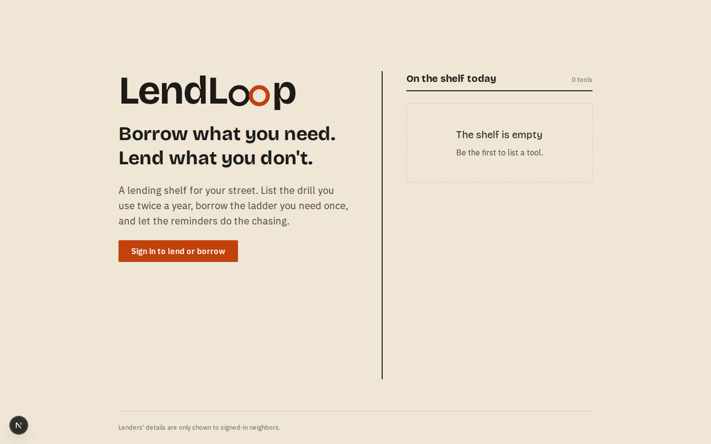
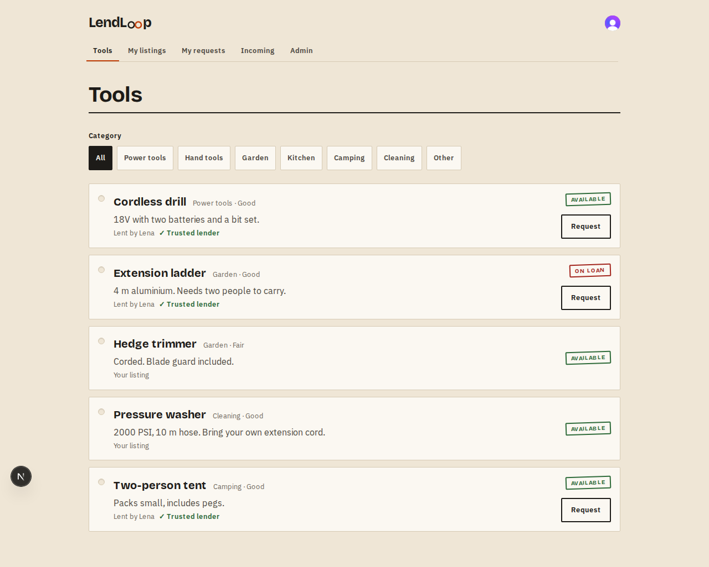
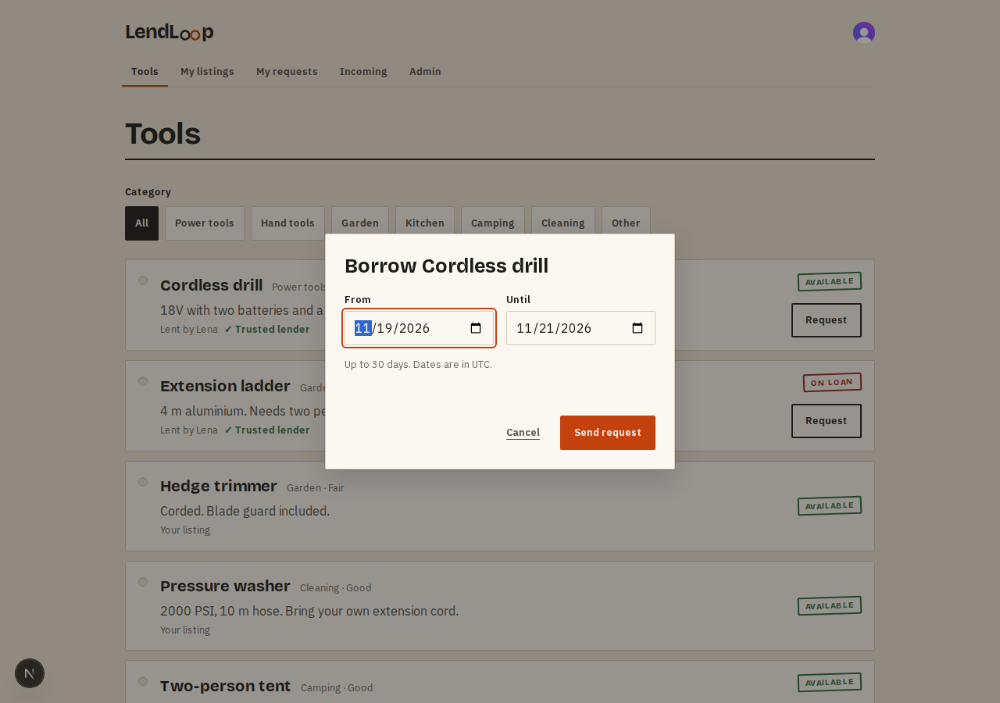
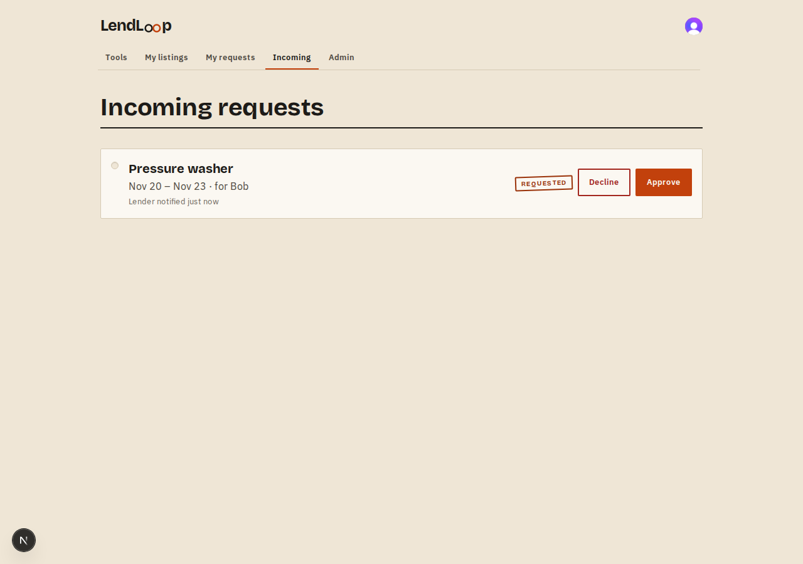
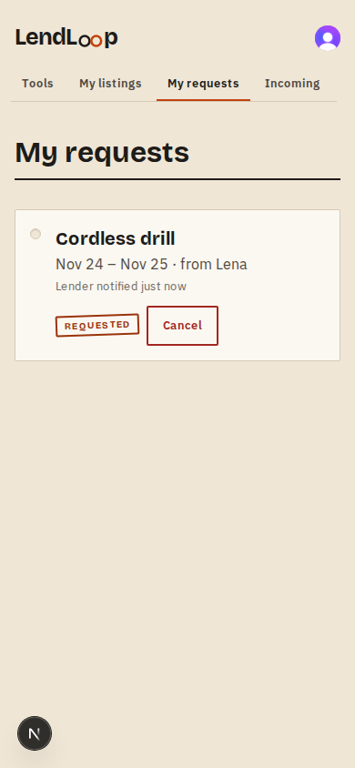
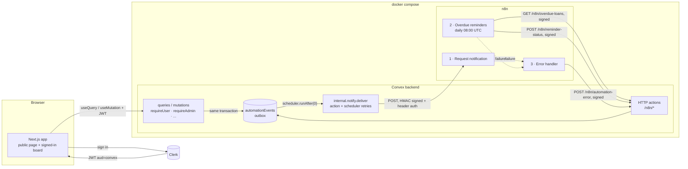

# LendLoop

**Borrow what you need. Lend what you don't.**
A neighborhood tool-lending board. Neighbors list tools, request them for a date range, and get notifications and overdue reminders through n8n.

Stack: Next.js 16 (App Router, TypeScript strict) · Tailwind CSS 4 · Clerk · Convex (self-hosted) · n8n · Vitest + convex-test.

| Public page | Tools board | Borrow dialog |
|---|---|---|
|  |  |  |
| **Incoming requests** | **My requests (mobile)** | |
|  |  | |

- [Quick start](#quick-start)
- [Architecture](#architecture)
- [Security design](#security-design): RBAC, HMAC signing, data minimization
- [Reliability design](#reliability-design): outbox, retries, idempotency, error workflow
- [Testing and failure drills](#testing-and-failure-drills)
- [Known limitations](#known-limitations) · [PRODUCTION.md](PRODUCTION.md) · [Decision log](docs/DECISIONS.md) · [SRS](docs/SRS.md)

---

## Quick start

**Prerequisites:** Node 20.9+ (tested on 24), Docker with Compose, a free Clerk account, `openssl`.

### 1. Clerk (about 3 minutes)

1. Create a Clerk application at <https://dashboard.clerk.com>.
2. **Integrations → Convex → Activate.** This makes Clerk issue tokens with `aud: "convex"`.
3. **Configure → Sessions → Customize session token**, add these claims so Convex knows the user's email and first name:
   ```json
   { "email": "{{user.primary_email_address}}", "given_name": "{{user.first_name}}" }
   ```
4. Copy the API keys into a new `.env` file in the repo root:
   ```bash
   NEXT_PUBLIC_CLERK_PUBLISHABLE_KEY=pk_test_...
   CLERK_SECRET_KEY=sk_test_...
   ADMIN_EMAILS=you@example.com   # optional: becomes admin on first sign-in
   ```

### 2. Everything else

```bash
npm install
./scripts/bootstrap.sh     # secrets, Docker, Convex admin key + env, functions, n8n workflows
npm run dev                # http://localhost:3000
```

`bootstrap.sh` is idempotent. It generates the HMAC secrets if they're missing, starts self-hosted Convex and n8n, writes `.env.local`, sets the Convex deployment env, pushes the functions, and imports and publishes the three n8n workflows. It never prints secret values.

Optional demo data (two neighbors, three tools, one pending request, one overdue loan):

```bash
npx convex run seed:demo
```

| URL | What |
|---|---|
| <http://localhost:3000> | App |
| <http://localhost:6791> | Convex dashboard (admin key is in `.env.local`) |
| <http://localhost:5678> | n8n (create the owner account on first visit to see the workflows) |

To make an existing user an admin: `npx convex run users:setRole '{"email":"you@example.com","role":"admin"}'`.

### Environment variables

| Name | Where | Set by | Purpose |
|---|---|---|---|
| `NEXT_PUBLIC_CLERK_PUBLISHABLE_KEY` | `.env` | you | Clerk frontend key |
| `CLERK_SECRET_KEY` | `.env` | you | Clerk server key (Next.js only; never reaches Convex) |
| `ADMIN_EMAILS` | `.env` → Convex | you (optional) | Admin bootstrap on first sign-in |
| `LENDLOOP_N8N_HMAC_SECRET` | `.env` → Convex + n8n | bootstrap | Convex signs, n8n verifies |
| `LENDLOOP_CONVEX_HMAC_SECRET` | `.env` → Convex + n8n | bootstrap | n8n signs, Convex verifies |
| `N8N_WEBHOOK_AUTH_TOKEN` | `.env` → Convex + n8n credential | bootstrap | Header Auth on the n8n webhook |
| `NEXT_PUBLIC_CONVEX_URL`, `CONVEX_SELF_HOSTED_URL`, `CONVEX_SELF_HOSTED_ADMIN_KEY` | `.env.local` | bootstrap | Convex client and CLI |
| `CLERK_JWT_ISSUER_DOMAIN` | Convex env | bootstrap (from the publishable key) | JWT issuer for `auth.config.ts` |
| `N8N_WEBHOOK_URL` | Convex env | bootstrap | `http://n8n:5678/webhook` |
| `CONVEX_HTTP_URL` | n8n container | `docker-compose.yml` | `http://backend:3211` |
| `LENDLOOP_FORCE_FAIL` | `.env` → n8n | you (drills only) | Makes the n8n send nodes throw |

`.env.example` lists every name with no values. All `.env*` files except the example are gitignored.

---

## Architecture



- **Next.js** renders the UI only. All data comes from Convex subscriptions. `proxy.ts` (Next 16's renamed middleware) redirects signed-out visitors away from app pages as a convenience. It is not a security boundary.
- **Clerk** proves identity. Convex verifies the JWT against Clerk's JWKS (`convex/auth.config.ts`).
- **Convex** is the backend and the only place authorization happens. Roles live in the Convex `users` table.
- **n8n** sends notifications and reminders. It talks to Convex only through signed HTTP, in both directions.
- **Self-hosted Convex runs in the same compose network as n8n**, so Convex can call `http://n8n:5678` and n8n can call `http://backend:3211` with no public tunnel.

### Code map

```
convex/
  schema.ts            users, tools, loanRequests, automationEvents (+ indexes)
  lib/auth.ts          requireUser / requireAdmin / requireToolOwner(OrAdmin) / requireLoanParty
  lib/loanState.ts     the SRS 4.4 state machine (single source of legal transitions)
  lib/dates.ts         FR-L2 date rules (UTC ISO strings), overlap
  lib/hmac.ts          sign / verify, Web Crypto, constant-time, 5-minute window
  lib/outbox.ts        enqueueLoanEvent: outbox row + scheduled delivery
  users.ts tools.ts loans.ts admin.ts public.ts   public functions (all guarded)
  notify.ts            internal: build minimal payload, deliver, retry/backoff
  automation.ts        internal: overdue list, idempotent reminder upsert, error records
  http.ts              /n8n/overdue-loans, /n8n/reminder-status, /n8n/automation-error
  seed.ts              internal demo data
app/                   page.tsx (public) and (app)/ tools, listings, requests, incoming, admin
components/ lib/       UI primitives, formatting, error mapping
n8n/workflows/         exported workflow JSON (no secrets)
scripts/               bootstrap.sh, n8n-setup.sh
```

---

## Security design

### RBAC lives in Convex

Every public query and mutation starts with one helper from `convex/lib/auth.ts`. The caller is always derived from `ctx.auth.getUserIdentity()`. No function accepts a user ID, owner ID or role from the client.

| Helper | Used by | Rule |
|---|---|---|
| `requireUser` | everything signed-in | valid Clerk JWT **and** a registered Convex user |
| `requireAdmin` | `admin.*`, `automation.recentIssues` | `role === "admin"` from the Convex row |
| `requireToolOwner` | `tools.update`, `tools.remove` | caller owns the listing |
| `requireLoanParty(..., ["owner"])` | `loans.approve`, `loans.decline` | caller owns the tool |
| `requireLoanParty(..., ["borrower"])` | `loans.cancel` | caller made the request |
| `requireLoanParty(..., ["owner","admin"])` | `loans.markReturned` | lender confirms the return; an admin may too |

- **Roles:** new users are `user`. Admins come from the CLI-only `internal.users.setRole`, or from `ADMIN_EMAILS` on **first** sign-in only, so a later demotion sticks. No client path can change a role.
- **Machine-only code is `internal*`:** delivery, the overdue list, write-backs and seeding can't be called from a browser.
- **Server-enforced state machine:** every transition goes through `nextStatus()`. Approval also rejects dates that overlap another approved loan (FR-L3).
- **Input validation:** Convex validators enforce the enums (category, condition, status). Lengths and control characters are checked at runtime, and dates are validated as real calendar dates. React renders all text as text, never as HTML.
- **Admin UI is cosmetic.** The nav link only shows for admins, and every admin function re-checks the role on the server.

### HMAC-signed integration, both directions

```
X-LendLoop-Timestamp: <unix seconds>
X-LendLoop-Event-Id:  <unique id>
X-LendLoop-Signature: hex( HMAC-SHA256( secret, timestamp + "." + rawBody ) )
```

| Direction | Secret | Signer | Verifier |
|---|---|---|---|
| Convex → n8n (`POST /webhook/lendloop/request-event`) | `LENDLOOP_N8N_HMAC_SECRET` | `notify.deliver` (Web Crypto) | n8n Code node "Verify signature" (`crypto.timingSafeEqual`) |
| n8n → Convex (`/n8n/*`) | `LENDLOOP_CONVEX_HMAC_SECRET` | n8n Code nodes | `convex/http.ts` → `lib/hmac.verify` |

- **One secret per direction**, so a leak on one side can't forge traffic the other way.
- **The signature covers the timestamp.** A request can't be re-dated, and anything older or newer than **5 minutes** is rejected. Replays inside the window are harmless because every write is idempotent (below).
- **Constant-time comparison** on both sides. Verification runs before any parsing or database work. Failures return a generic `401` (`503` if the secret isn't configured); the reason goes only to server logs.
- **Header auth on the n8n webhook** (`X-LendLoop-Auth`, an n8n credential) is a cheap first gate. Without it n8n answers `403` before the workflow runs.
- **The n8n secrets come from the container env** (`$env.*`, `N8N_BLOCK_ENV_ACCESS_IN_NODE=false`), and the header token from an n8n credential. That's why the exported workflow JSON holds no secret values; see the [secret check](#secret-scanning).
- The webhook verifies the raw body bytes (Webhook node *Raw Body* option), not a re-serialized object.

### Data minimization

- **Public page:** `public.listAvailable` builds a `{ name, category }` projection on the server. No IDs, owner fields, condition or description.
- **Signed-in users** see a lender's first name and Trusted badge, never their email.
- **Webhook payload** (Convex → n8n): only `eventId`, `type`, `loanId`, `status`, `recipient {email, firstName}`, `tool {name}`, `dates`, `occurredAt`.
- **Overdue endpoint:** only `loanId`, `idempotencyKey`, `borrower {email, firstName}`, `toolName`, `endDate`, `daysOverdue`.
- **n8n keeps no data from successful executions** (`EXECUTIONS_DATA_SAVE_ON_SUCCESS=none`, pruning after 7 days). The mock channel logs masked addresses (`l***@example.com`).
- **Logs** carry event ids, workflow and node names, and error messages, never payloads.

### Secret scanning

- A gitleaks **pre-commit hook** (`.githooks/pre-commit`, enabled by `npm install`) blocks commits that contain secrets.
- `npm run secrets` scans the whole git history.
- Check the exported workflows directly:
  ```bash
  set -a; . ./.env; set +a
  for v in "$LENDLOOP_N8N_HMAC_SECRET" "$LENDLOOP_CONVEX_HMAC_SECRET" "$N8N_WEBHOOK_AUTH_TOKEN" "$CLERK_SECRET_KEY"; do
    grep -rlF "$v" n8n/ convex/ app/ && echo "LEAK" || true
  done
  ```

---

## Reliability design

**Transactional outbox (Convex → n8n).**
1. Every loan status change inserts an `automationEvents` row (`queued`, unique `eventId`) **in the same transaction** as the change.
2. It then calls `scheduler.runAfter(0, internal.notify.deliver)`, so delivery runs only after the mutation commits.
3. A delivery failure can never fail or roll back the user's action.

**Retries with backoff.** `deliver` makes up to 4 attempts: right away, then after 30 s, 2 min and 10 min. Each failure records `lastError`. After the last attempt the event becomes `failed`, appears under **Admin → Automation issues**, and is logged. A non-2xx response counts as a failure, and requests time out after 10 s.

**Stalled-delivery sweep.** Convex doesn't retry actions, so a delivery that dies between the HTTP call and its bookkeeping would leave an event `queued` forever. A cron (`convex/crons.ts`, every 15 min) re-queues outbound events nobody has touched for 15 minutes, or marks them `failed` if every attempt is used. A stale `request.created` (for example retried after the borrower cancelled) is settled as skipped instead of being sent.

**Idempotency.**

| Where | Key | Behaviour |
|---|---|---|
| n8n request notifications | `eventId` | Remembered in workflow static data **after** a successful send. A redelivery is answered `200 duplicate` and not re-sent. |
| Reminder write-back | `reminder:{loanId}:{YYYY-MM-DD}` | Upsert on `idempotencyKey`. A `sent` record is never changed. A `failed` one can be upgraded to `sent` by a retry. |
| Overdue list | — | Loans already reminded (`sent`) today are left out, so a rerun sends nothing new. Failed ones are listed again for retry. |
| Error write-back | `error:{executionId}` | One record per failed n8n execution. |

**n8n side.**
- The HTTP and send nodes use **Retry On Fail** (3 tries, with waits).
- Workflows 1 and 2 have **workflow 3 attached as their error workflow**.
- Workflow 3 logs the failure to the container log and writes a signed record to `POST /n8n/automation-error`, which shows up under Admin → Automation issues.
- In the reminder workflow, a failed send goes down the error branch and is **written back as `failed`** (RR-5). The run then deliberately fails so the error workflow fires too.

---

## Testing and failure drills

```bash
npm test                      # 88 tests: vitest + convex-test
npm run lint && npm run typecheck
npm run secrets               # gitleaks over git history
```

| Suite | Covers |
|---|---|
| `convex/rbac.test.ts` | signed-out rejection, forged IDs on others' tools and loans, admin-only functions, role bootstrap |
| `convex/loans.test.ts` | date rules, every invalid transition, overlap check, deletion guard, availability and overdue, outbox |
| `convex/public.test.ts` | the public projection has exactly `{name, category}` and leaks nothing about owners |
| `convex/integration.test.ts` | HTTP signature rejection (missing, wrong, expired, tampered), idempotent reminders, error write-back, signed minimal payload, retry → `failed` with n8n down |
| `convex/lib/*.test.ts` | HMAC against an openssl reference vector, 5-minute window both ways, dates |
| `tests/n8nWorkflows.test.ts` | runs the n8n Code-node `jsCode` from the exported JSON: verify (tampered, expired, wrong secret, eventId mismatch), dedupe only after send, every signer cross-checked against `lib/hmac.ts`, force-fail, masked logs |

**Live drills** against the running stack, mapped to SRS §11 (all run during development):

| # | Drill | Result |
|---|---|---|
| 1 | Open the public page signed out; check the network tab | `listAvailable` returns `[{name, category}]` only |
| 2–3 | Forged IDs / non-admin calls | covered by `rbac.test.ts`; every call returns `FORBIDDEN` |
| 4 | `curl` the n8n webhook and `/n8n/overdue-loans` without auth, with a bad signature, with a 400 s old timestamp | n8n `403` / `401` / `401`; Convex `401` / `401` / `401`; valid control `200` |
| 5 | Run the reminder workflow twice: `docker compose exec -e N8N_RUNNERS_BROKER_PORT=5690 n8n n8n execute --id=lendloopRemindWf` | one `reminder.overdue` record per loan |
| 6 | `docker compose stop n8n`, then request a tool | the request succeeds in ~1 s; the event goes `queued` → `failed` after 4 attempts with `lastError` |
| 7 | `LENDLOOP_FORCE_FAIL=true docker compose up -d n8n`, then trigger any event | the error workflow fires; "Request notification › Send notification (mock)" shows in Admin → Automation issues and in `docker compose logs n8n` |
| 8 | Secret grep above, plus `npm run secrets` | no matches |

---

## Known limitations

- **Mock notification channel.** Messages go to the n8n container log. Swapping in the Email (SMTP) or Slack node with a credential is a one-node change.
- **n8n dedupe state** is workflow static data. It's fine for one instance; queue mode with several workers would need a shared store (Redis or Postgres).
- **List queries read whole tables** (`collect()`), which is fine for a neighborhood. Pagination and an availability index are in PRODUCTION.md.
- **Dates are UTC calendar dates.** A user far from UTC may see "today" roll over at an unexpected local time.
- Only the lender (or an admin) can mark a loan returned. Borrowers can't, by design (SRS FR-A5).
